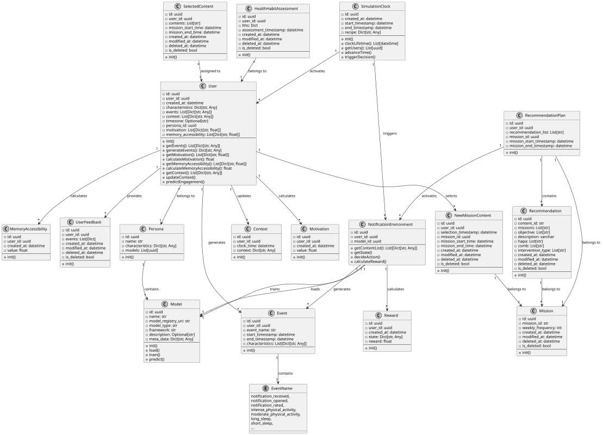

[](https://ibechange.eu/)


# ibechange-omi-fastapi

[](LICENSE)
[](docs/review-verification.md#validation)

# Data model


Opportune Moment Identification (OMI) of Behavior Change Recommendations (iBeChange-2025)

## Deploy

Copy `.env.example` to `.env`, set the database credentials and the Artemis
host, credentials and assigned queue, and choose `POLICY_LEARNING_MODE=online`
for per-user fitting or `frozen` for a fixed trial policy.

```bash
docker volume create metabase_data
docker compose up --build -d
docker compose logs app
docker compose down
```

Compose runs bootstrap/migrations before the API, Artemis consumer and policy
worker. Code and artifacts are baked into the image; rebuild it after changes.
PostgreSQL persists plans, replay and per-user optimizer checkpoints across
container restarts. The external `metabase_data` volume remains required by the
existing analytics services.

Run checks against the dedicated disposable test database, separated from the
application database:

```bash
docker compose --profile checks run --build --rm tests
```

For local development, install `requirements-dev.txt`, point `POSTGRES_*` and
`TEST_DATABASE_URL` at a test PostgreSQL instance, and run:

```bash
black --check app scripts tests migrations
isort --check-only app scripts tests migrations
pytest --cov=app --cov-branch --cov-report=term-missing --cov-fail-under=99 tests/
```

The [review verification](docs/review-verification.md) evaluates every RL review
finding. [RL persistence](docs/rl-data-model.md) supplements the earlier diagram.

### Selected Content

```bash
curl -X POST "http://localhost:3200/selected_contents/" -H "Content-Type: application/json" -d '{
  "474dbf4c-8922-4dac-aa35-92632a7bcaf8": {
    "contents": [
      { "id": "NRs6", "type": "resource", "mission_id": "NM31" },
      { "id": "NRc54", "type": "recommendation", "mission_id": "NM31" },
      { "id": "NRc54", "type": "recommendation", "mission_id": "NM31" },
      { "id": "NRc53", "type": "recommendation", "mission_id": "NM31" },
      { "id": "NRc20", "type": "recommendation", "mission_id": "NM31" },
      { "id": "NRc53", "type": "recommendation", "mission_id": "NM31" },
      { "id": "NRc54", "type": "recommendation", "mission_id": "NM31" },
      { "id": "NRc53", "type": "recommendation", "mission_id": "NM31" }
    ],
    "mission_start_time": "2025-12-01T10:00:33.919000",
    "mission_end_time": "2025-12-31T10:00:33.919000",
    "plan_id": "7b8a9f54-801a-4ab0-afe0-06f100441793"
  },
  "10b58b39-9a4c-46ad-b98d-03dc28735e6b": {
    "contents": [
      { "id": "NRc30", "type": "recommendation", "mission_id": "NM31" },
      { "id": "NRc54", "type": "recommendation", "mission_id": "NM31" },
      { "id": "NRc53", "type": "recommendation", "mission_id": "NM31" },
      { "id": "NRc54", "type": "recommendation", "mission_id": "NM31" },
      { "id": "NRc53", "type": "recommendation", "mission_id": "NM31" },
      { "id": "NRc53", "type": "recommendation", "mission_id": "NM31" },
      { "id": "NRc54", "type": "recommendation", "mission_id": "NM31" },
      { "id": "NRc19", "type": "recommendation", "mission_id": "NM31" },
      { "id": "NRc53", "type": "recommendation", "mission_id": "NM31" }
    ],
    "mission_start_time": "2025-12-01T10:00:33.919000",
    "mission_end_time": "2025-12-31T10:00:33.919000",
    "plan_id": "3b8a9f54-701a-1ab0-afe0-05f100441796"
  }
}'
```

```bash
curl "http://localhost:3200/selected_contents/"
```

### Recommendation Plan

```bash
curl "http://localhost:3200/recommendation_plans/?start_time=2025-12-03T17:00:00&end_time=2025-12-07T21:00:00"
```

### Notification Plan

```bash
curl "http://localhost:3200/notification_plans/?start_time=2025-12-03T17:00:00&end_time=2025-12-07T21:00:00"
```

### Artemis updates

The `/updates` HTTP endpoint has been replaced by a STOMP consumer. Set the
`ARTEMIS_*` variables in `.env`, including the queue assigned to this service,
then apply the database migration and start the consumer as a separate process.
Compose initializes fresh databases and migrates existing installations.

```bash
python -m app.bootstrap
python -m app.artemis_consumer --queue int.ibechange.update::tue-updates-int
```

Each message has one top-level event key. For example:

```json
{"new_pillar": {"user_uuid": "3a6f5cbc-3e91-4a7a-8b41-7ce6bbd3372f", "pillars": "NO"}}
```

The consumer accepts the twelve captured event types in `app/schemas/update.py`, including
`task_step_scheduled`, `task_step_done`, and `mission_accomplished`, plus
`notification_plan` proposals. Proposals are retained without counting them as
confirmed deliveries. A scheduled
task message gives one `scheduled_for` interval per reported step. OMI records
the original `startDate` and `endDate` strings and updates the active intervals
for that mission process when Artemis sends a later schedule. Completion events
retain their process IDs and source times. Psychological assessment messages in
the supplied capture have no `user_uuid`; they are stored with an empty user
link and their complete source payload so they can be assigned later if the
producer supplies a reliable identifier.

`docs/artemis_example.json` is a diagnostic consumer transcript with embedded
JSON bodies, not a single JSON document. The ingestion tests parse every body
from that capture.

The consumer acknowledges a message only after its database transaction commits.
Invalid messages are recorded in `ArtemisFailure` before acknowledgement.

### Policy artifacts

The `app/policy_artifacts` directory contains exported `con_cddqn` weights for
participants with and without wearable inputs. Their bundled metadata records fitting on 20,000
simulated behavior decisions per state width from the RL project's
`data/learn/wearable_940/decisions.csv.gz`, using 2,000 offline updates and seed
`20260928`. The JSON files record state fields, source paths, configuration,
and a hash of the training sample. The application needs only NumPy to load the
weights. Both artifacts are checked when the API starts, and startup fails if
either file is missing or has an incompatible state layout. Recreating them
uses the local runtime and a behavior log with reward arm **A** (engagement plus
unopened-send cost). The current reference run at the historical path may use
arm F; it cannot reconstruct the original sample from that run. Use an explicit
arm-A log and its matching run metadata:

```bash
python -m scripts.train_policy_artifacts \
  --log /path/to/arm-a/decisions.csv.gz \
  --run /path/to/arm-a/run.json \
  --out app/policy_artifacts --limit 20000 --steps 2000 --seed 20260928
```

`POLICY_LEARNING_MODE=online` starts a separate learner for each user and device
from these weights. Its replay, target network, Adam state, refit cadence and
random-generator state persist in PostgreSQL. Confirmed `notification_sent`
events provide delivery evidence, and matched opens provide engagement after
the response window closes. The reward combines engagement and unopened-send
cost, with elapsed-time discounting and CQL over feasible actions. Every decision
records its exact model/configuration revision. `frozen` records outcomes while
keeping serving weights fixed. The local runtime's source license and hashes are
in [app/rl/NOTICE.md](app/rl/NOTICE.md).

New exports include complete training settings and optional offline replay.
The bundled artifacts have no replay archive, so live fitting initially samples
only each user's own released transitions. Their previously missing settings
are identified by `runtime_training_defaults` in the metadata. Raw Oura readings
need a calibrated mapping to the model's standardized channels; until one is
provided, wearers use the model's missing-reading block.

These weights use the research simulator's two item classes. The application
maps resources to its recommendation class and keeps reminders in the deadline
class. The latest `/selected_contents` list supplies the ordered queue at each
decision epoch. Repeated updates leave completed occurrences unchanged. The
policy requires one to two reminders and one to two recommendations or resources
per local day when each class is present in that day's ordered queue. If the
queue order and remaining class budgets cannot include one of a supplied class,
the endpoint reports an infeasible queue. These limits are fixed in the serving
policy; the old `MIN_NOTIFICATIONS_*` and `MAX_NOTIFICATIONS_*` environment
settings are unused. The model artifact supplies the total weekly cap. Serving
does not impose a weekly minimum because the supplied queue may have fewer
items. `POLICY_TIMEZONE` sets the local day, with `Europe/Berlin` as the default.
The `policy-worker` runs every real decision grid epoch. The plan endpoints can
also commit their next grid epoch, at most one grid interval ahead, using only
information already observed when the request arrives. Concurrent worker/API
calls keep one action per user and epoch. Downtime is not filled with simulated
historical decisions. The delivery integration must retrieve and deliver the
committed plans; the mask guarantees feasible planning while actual delivery
requires that integration and later broker confirmations.
An unresolved reminder has no safe send action. The plan endpoint reports that
queue as infeasible. For each reminder, OMI matches active Artemis
`task_step_scheduled` intervals by user UUID and mission ID. It uses the latest
`endDate` **on the local decision day** as that day's hard deadline. A later
Artemis schedule snapshot replaces the previous intervals for that mission
process. The selected-content queue supplies the order and mission ID; its
optional process and step IDs do not select the deadline. If no matching step
ends on the decision day, OMI uses the selected mission's `mission_end_time`.
When that end time is null, the deadline is seven days after
`mission_start_time`. If both times are missing, or today's matching step has
an ambiguous `endDate`, the deadline is unresolved. A reminder cannot be sent
after its resolved deadline. An expired deadline leaves no safe action in the
constraint mask, so the endpoint reports the queue as infeasible. Artemis
timestamps without an offset use
`ARTEMIS_SCHEDULE_TIMEZONE`, which defaults to `POLICY_TIMEZONE`.

The selected-content list can contain more than two items for a mission. OMI
keeps the remaining occurrences for later days after two reminders or two
recommendation-class items (recommendations and resources together) have been
sent on one local day.

For example, POLIMI CS may send the following queue repeatedly. The order and
duplicate entries are retained. A new payload with the same `plan_id` replaces
the current order.

```json
{
  "3a6f5cbc-3e91-4a7a-8b41-7ce6bbd3372f": {
    "plan_id": "1b1a1f51-701a-1ab0-afe0-05f100441796",
    "contents": [
      {"id": "NRc1", "type": "recommendation", "mission_id": "NM1"},
      {"id": "NMr1", "type": "reminder", "mission_id": "NM1"},
      {"id": "NRs2", "type": "resource", "mission_id": "NM1"}
    ]
  }
}
```

### Physical Activity

```bash
curl -X POST "http://localhost:3200/physical_activity/" \
     -H "Content-Type: application/json" \
     --data-binary @docs/physical_activity_example.json
```

### Emotional Wellbeing

```bash
curl -X POST "http://localhost:3200/emotional_wellbeing/" \
     -H "Content-Type: application/json" \
     --data-binary @docs/emotional_wellbeing_example.json
```
