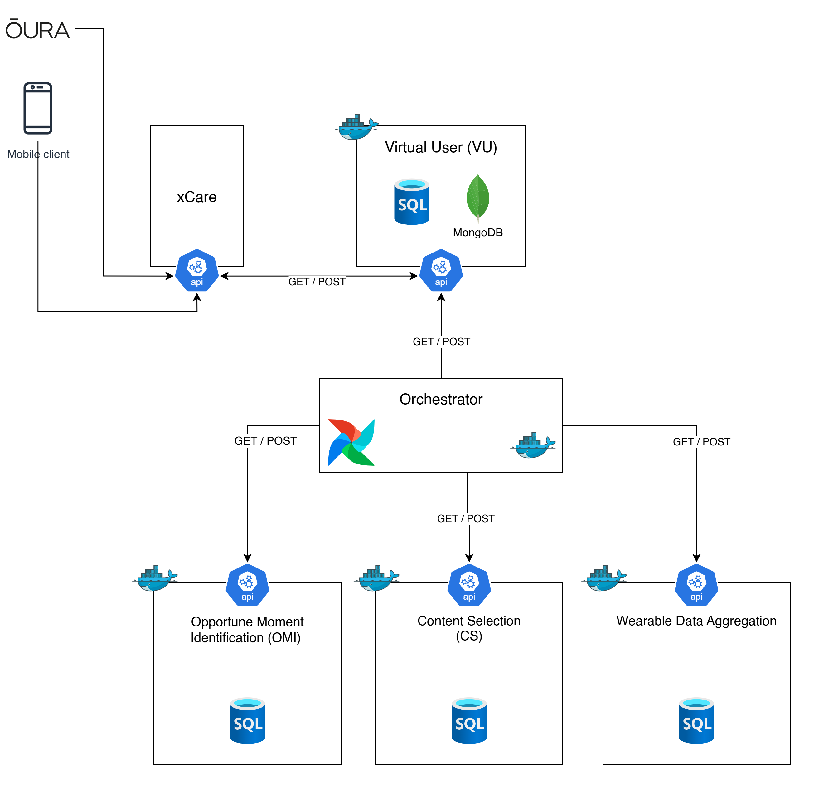
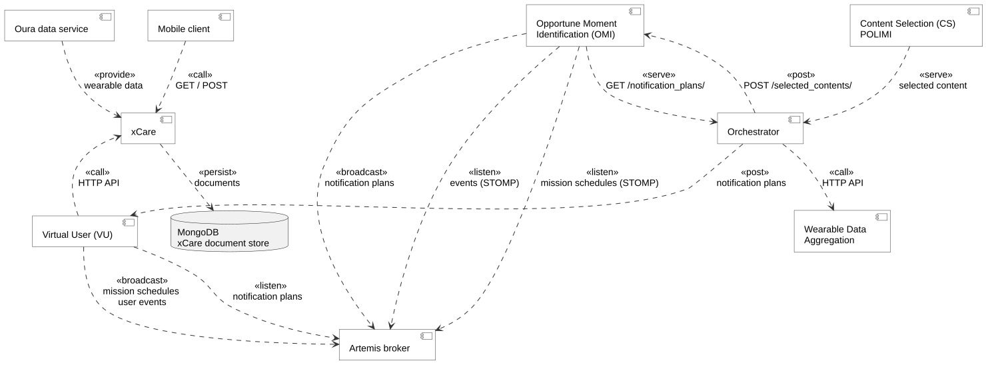
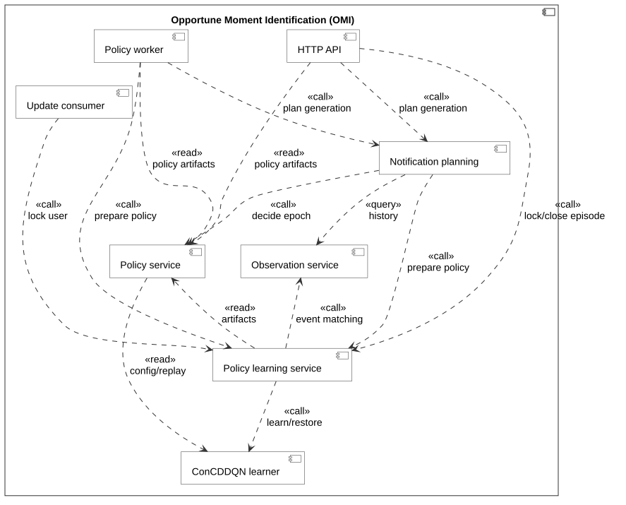

[](https://ibechange.eu/)


# ibechange-omi-fastapi

[](LICENSE)
[](docs/review-verification.md#validation)

OMI selects when to send the next item in the ordered iBeChange content queue.
The delivered algorithm is constrained conservative Double DQN (ConCDDQN).
It learns from confirmed deliveries and observed openings while the action mask
enforces quiet hours, spacing, queue order, delivery limits and reminder deadlines.
FastAPI, a real-time policy worker and an Artemis consumer share PostgreSQL.
The [implementation guide](docs/implementation.md) describes the selected settings,
formal-component mapping, shared offline replay and simulation reproduction.

## Diagrams



The workflow shows how OMI exchanges selections, notification plans and events
with the other iBeChange modules.





## Local setup

Install Docker Engine with Docker Compose. From the repository root, create a
local environment file if you do not already have one. The example credentials
are for local use.

```bash
test -f .env || cp .env.example .env
```

### Run a synthetic learning simulation

The `learning-check` service runs the shipped OMI policy and learner on
synthetic participants' responses. It requires the repository's model artifacts
and Docker, with no CS, EUT, Artemis or database service. The response
probabilities are artificial, so these runs check the software rather than
reproduce the calibrated research study.

Run online learning and inspect the results:

```bash
docker compose --profile tools run --build --rm --no-deps learning-check
cat build/online/summary.json
```

Run the fixed-policy comparison:

```bash
docker compose --profile tools run --build --rm --no-deps learning-check-frozen
cat build/frozen/summary.json
```

Each default run simulates 14 days for the nonwearer model and writes
`daily.csv`, `summary.json`, a checkpoint and per-day audit files in its
output directory. The online run updates the personal model. The frozen run
keeps the shipped weights fixed. Both commands resume their existing
checkpoint if present. To start a separate run or test the wearer model,
choose a new output and checkpoint path:

```bash
docker compose --profile tools run --build --rm --no-deps learning-check \
  python -m scripts.check_policy_learning --days 14 --seed 11 --device wearer \
  --out build/wearer-check --checkpoint build/wearer-check/checkpoint.json
```

Use the same seed, mode, device and checkpoint when resuming. `--days` is
the total desired duration, not the number of additional days. The
[implementation guide](docs/implementation.md#reproducing-the-calibrated-simulation-studies)
describes the separate research simulator and its additional dependencies.

### Run the local API and worker

Start PostgreSQL, migrations, the API and policy worker without the Artemis
consumer or Metabase:

```bash
docker compose up -d --build db migrate app policy-worker
docker compose ps db migrate app policy-worker
```

Open [http://localhost:3200/docs](http://localhost:3200/docs) for the API.
Submit test selections through the API to exercise the local service. Without
Artemis, delivery confirmations and user feedback must be supplied by a test
fixture for learning to observe them. The synthetic learning check above
generates its own artificial responses.

```bash
docker compose logs -f app policy-worker
```

Stop the local services:

```bash
docker compose down
```

The PostgreSQL volume retains data across restarts. To run the full integration,
set the broker and delivery settings in `.env`, create the external Metabase
volume, and start all default services:

```bash
docker volume create metabase_data
docker compose up -d --build
docker compose ps
docker compose logs -f app policy-worker artemis-consumer
```

Cronicle runs separately. On the INT server, include the certificate overlay
when starting OMI:

```bash
export COMPOSE_FILE=docker-compose.yml:compose.int.yml
docker compose up -d --build
```

Set `ARTEMIS_CA_CERT` to the certificate path on that host. Configure
`CS_BASE_URL`, `OMI_BASE_URL` and `EUT_PRE_BASE_URL` in the Cronicle
process. INT uses token-free delivery when `EUT_PRE_TOKEN` is empty.

### Run automated tests

The checks profile builds a development image and starts a separate disposable
PostgreSQL service. It runs formatting checks and the test suite with coverage,
without CS, EUT or Artemis.

```bash
docker compose --profile checks run --build --rm tests
```

The current suite has five failing delivery-script assertions. They expect the
previous EUT URL or CS posting order, while the revised script posts to EUT
first and uses a trailing slash. Review the delivery behavior and tests
together before relying on a passing suite.

Current implementation verification is documented in
[docs/verification/README.md](docs/verification/README.md). The
[RL persistence guide](docs/rl-data-model.md) describes the stored records.

### Runtime services

The runtime requires PostgreSQL 15; the container uses Python 3.13 with the
dependencies in `requirements.txt` (development checks add
`requirements-dev.txt`). FastAPI/Uvicorn serve HTTP, SQLModel/SQLAlchemy and
Alembic manage persistence, `stomp.py` consumes broker messages, and NumPy
implements the network and optimizer. A GPU is unnecessary.

The full integration starts these long-lived Compose services: the API (`app`, port 3200), the Artemis
consumer (`artemis-consumer`, queue from `ARTEMIS_QUEUE`) and the policy
worker (`policy-worker`); migrations run first via the `migrate` service.

The API schema is available at `/docs`. `POSTGRES_*` selects the database,
`ARTEMIS_*` selects the assigned broker queue and optional TLS files,
`POLICY_TIMEZONE` sets local delivery days, and `ARTEMIS_SCHEDULE_TIMEZONE`
interprets offset-free task timestamps. `POLICY_ARTIFACT_DIR` optionally selects
an alternative artifact directory. Restart the processes after changing artifacts.

### Selected Content

The example uses a historical delivery date. Replace the dates and times with
the current local day to exercise current planning.

```bash
curl -X POST "http://localhost:3200/selected_contents/" -H "Content-Type: application/json" -d '{
  "474dbf4c-8922-4dac-aa35-92632a7bcaf8": {
    "plan_id": "1842.0",
    "created_at": "2026-11-05T01:05:12",
    "delivery_date": "2026-11-05",
    "mission_id": "PM3",
    "mission_process_id": 864536,
    "mission_start_time": "2026-11-03T08:12:40",
    "mission_end_time": null,
    "task_scheduled_for": "2026-11-05T18:00:00",
    "contents": [
      {"id": "PRc12", "type": "recommendation", "latest_time": null},
      {"id": "PRh1", "type": "hour_reminder", "latest_time": null},
      {"id": "PRd5", "type": "day_reminder", "latest_time": "2026-11-05T19:00:00"}
    ]
  }
}'
```

```bash
curl "http://localhost:3200/selected_contents/"
```

CS sends one ordered revision per participant and local delivery date. A later
`created_at` and new `plan_id` replace outstanding entries for that date. An
empty list cancels them. Confirmed sends retain their decisions and outcomes.
A revision received before a committed grid slot can replace that slot. OMI retains the superseded proposal and links the preceding transition to the replacement decision.
OMI interprets offset-free daily CS timestamps in `POLICY_TIMEZONE`. Supply an
explicit offset during a daylight-saving clock change. The API also accepts the
earlier UUID-based queues with per-item mission IDs.

The task time and each item's `latest_time` are exclusive cutoffs. Both reminder
types use the reminder policy class. The hour reminder prefers the final hour
before the task. If a subsequent item needs that slot, OMI moves the hour
reminder to the latest earlier slot that satisfies order, spacing and deadlines.
In the example above, 16:45 and 17:45 are the latest feasible reminder slots
under the 15-minute grid and 60-minute spacing.

### Recommendation Plan

These example windows use historical dates. Change them to the interval you
want to inspect.

```bash
curl "http://localhost:3200/recommendation_plans/?start_time=2025-12-03T17:00:00&end_time=2025-12-07T21:00:00"
```

### Notification Plan

```bash
curl "http://localhost:3200/notification_plans/?start_time=2025-12-03T17:00:00&end_time=2025-12-07T21:00:00"
```

For orchestrated delivery, refresh CS selections hourly and poll OMI at least
once per decision grid, ahead of the desired send. The worker commits one epoch
at a time. The reference integration supports `--dag_id 2` to refresh and
deliver, and `--dag_id 3 --delivery-only` to deliver between refreshes. The
default delivery mode, `--delivery vu`, posts notification plans to the EUT
endpoint `/internal/recommendations/` and then posts the corresponding committed
plans to CS after EUT accepts the batch. An INFO entry records the
HTTP status and notification count for each accepted batch. With `--delivery artemis`, it publishes a
proposal per send with a stable broker duplicate-detection ID. Configure
`CS_BASE_URL`, `OMI_BASE_URL` and the selected delivery destination. Cancelling
a revision updates OMI's retrieval endpoints. A recipient that has already
copied a proposal needs to reconcile it before dispatch.

In INT, the Cronicle pipeline uses `http://cs-rct-cs-api-1:8000` for CS. It
uses this address when `CS_BASE_URL` is empty or contains the old
`http://cs_module:8000` address. Other explicitly configured CS URLs take
precedence. The hourly job logs the participant count and number of content
items per delivery date after OMI acknowledges the refresh.

Cronicle requests both plan endpoints with `skip_infeasible=true`. If a
participant's queue exceeds a daily limit or violates another scheduling
constraint, OMI rolls back that participant's decision for the epoch, logs the
participant, plan ID and reason, and continues processing the other queues.
Both endpoints return committed sends in their usual response format, including
an empty result when nothing is due. The `X-OMI-Infeasible-Participants`
response header gives the number skipped on that request, which Cronicle logs.
Requests without this option retain the HTTP 409 diagnostic. CS can submit a
corrected daily revision with a new plan ID and later creation timestamp.

### Artemis updates

The `/updates` HTTP endpoint has been replaced by a STOMP consumer. Set the
`ARTEMIS_*` variables in `.env`, including the queue assigned to this service
(`ARTEMIS_QUEUE`), then start it with Compose; migrations run first:

```bash
docker compose up --build -d artemis-consumer
docker compose logs -f artemis-consumer
```

Each message has one top-level event key. For example:

```json
{"new_pillar": {"user_uuid": "3a6f5cbc-3e91-4a7a-8b41-7ce6bbd3372f", "pillars": "NO"}}
```

The consumer accepts the captured Artemis events, the revised mission and task
field names, mission changes and unsuccessful endings, notification ratings,
saves and unsaves, and resource-link openings. It stores push-text IDs and
routes with the source event. The existing reward uses confirmed sends and
matched opens. A `notification_plan` is recorded as a proposal. The scheduler
accepts a snapshot containing up to the mission's total step count. OMI records
the original `startDate` and `endDate` strings and updates the active intervals
for that mission process when Artemis sends a later schedule. Completion events
retain their process IDs and source times. Psychological assessment messages in
the supplied capture have no `user_uuid`; they are stored with an empty user
link and their complete source payload so they can be assigned later if the
producer supplies a reliable identifier.

`docs/artemis_example.json` is a diagnostic consumer transcript with embedded
JSON bodies, not a single JSON document. The ingestion tests parse every body
from that capture.

The consumer acknowledges a message only after its database transaction commits.
Invalid messages are recorded in `ArtemisFailure` before acknowledgement.

### Policy artifacts

The `app/policy_artifacts` directory contains separate 32-input and 36-input
models for nonwearers and wearers, each with one 64-unit ReLU hidden layer and
two action values. Each model was fitted with 2,000 offline updates on 20,000
simulated behavior transitions, using seed `20261104` and
[the selected configuration](configs/omi_concddqn.json). The sample covers all
900 nonwearers and 40 wearers in the archived cohort. Sampling within each
participant's recorded timeline is random and reproducible; nonwearers contribute
22 or 23 transitions each and wearers contribute 500 each. All four simulated
behavior profiles are represented in each device dataset. Profile labels describe
training coverage only; the service selects a model using wearable status alone.

The exported replay is shared by new participants with the corresponding device
status. Every online batch contains eight shared offline transitions and 24
transitions from the current RCT participant. A new participant needs no personal
pretrial history, pilot identity match or cluster assignment. Each participant
receives their own copy of the initial weights and has separate online replay
and optimizer state. The JSON files record configuration, state order and hashes
of the sample, source run, weights, replay and detailed sampling records.
Startup validates both models and the required replay archives.

To export artifacts from compatible simulation decisions, place
`decisions.csv.gz` and `run.json` in a directory and set its path. The
exporter writes to `build/policy_artifacts`:

```bash
export OMI_PRETRAINING_DATA_DIR=/absolute/path/to/pretraining-data
docker compose --profile tools run --build --rm export-artifacts
```

The exporter accepts reward arm A or F. For F, it removes the recorded volume
and pacing contributions using the source run settings and the logged delivery
count, then checks the recovered engagement and unopened-send reward. It rejects
incompatible state or constraint settings. The current bundled models use F logs.

`POLICY_LEARNING_MODE=online` starts a separate learner for each user and device
from these weights. Its replay, target network, Adam state, refit day and
random-generator state persist in PostgreSQL. Confirmed `notification_sent`
events provide delivery evidence, and matched opens provide engagement after
the response window closes. The reward combines engagement and unopened-send
cost, with elapsed-time discounting and CQL over feasible actions. Every decision
records its exact model/configuration revision. `frozen` records outcomes while
using the fixed bundled artifact, without fitting or exploration. It does not
serve a previously fitted participant checkpoint in frozen mode.

### Resume a participant at a time checkpoint

With `POLICY_LEARNING_MODE=online`, restarting the API or worker against the
same PostgreSQL database automatically continues from the latest committed
checkpoint. Decisions, pending feedback and consumed replay rows persist across
restarts. Keep the matching model, configuration and shared replay archive.

For an independent continuation at an earlier instant, export the learner on
a machine with the same database settings and artifact directory. Supply the
participant UUID, device and an offset-qualified time.

```bash
python -m scripts.export_policy_checkpoint --user 474dbf4c-8922-4dac-aa35-92632a7bcaf8 --device nonwearer --at 2026-11-18T14:30:00+01:00 --out build/participant.json
```

The export includes the participant's start time, policy time zone, both networks,
Adam state, sampling generator, refit day, update credits and retained replay.
To continue the exported learner in a separate process:

```python
import json
from pathlib import Path
from app.rl.learner import ConstrainedConservativeDoubleDQN
from app.services.rl_policy import load_policy_artifacts

saved = json.loads(Path("build/participant.json").read_text(encoding="utf-8"))
learner = ConstrainedConservativeDoubleDQN(load_policy_artifacts()[saved["device"]])
learner.restore_portable(saved)
# learner.learn(released_rows, day) uses local calendar days since saved["started_at"].
```

The live worker owns the production timeline. The export reads its ledger and
can be used to fit a separate copy. Migration `20261120_07` preserves each
existing learner's latest checkpoint as its earliest historical restore point.
The earlier schema overwrote preceding optimizer states.

For offline pretraining, add `--checkpoint-dir build/pretraining-checkpoints` to
the exporter command. It resumes each device optimizer after reselecting and
verifying the same training sample. Repeat the original command with the same
target step count, source data, configuration and seed. The synthetic learning
check accepts `--checkpoint build/check-day.json` and `--device wearer` or
`nonwearer`. Its `--days` value is the total run length. The Compose tools use
separate checkpoint paths for pretraining, online verification and frozen verification.

### Inspect decision and training history

| Stored record | Contents |
|---|---|
| PostgreSQL `PolicyDecision` | Participant, epoch, plan occurrence, exact policy revision, observation, feasible actions, chosen action and its propensity. `q_values` and `action_probabilities` both use the order **skip, send**, including forced decisions. |
| PostgreSQL `PolicyTrainingUpdate` | One row per learner and optimizer step. `fitted_at` is the policy epoch. Each row records the learning rate, CQL coefficient, mean squared TD loss, unweighted safe-action CQL loss, total loss, mean absolute TD error, ordered draw indices, pre-update Q-values, TD targets and signed residuals. Total loss equals TD loss plus the CQL coefficient times CQL loss. |
| Offline `con_cddqn_<device>.training.json.gz` | Shared pretraining history, replay archive checksum, completed update count and source rows. Each source row identifies the one-based CSV data record (header excluded), source participant, day and logged chosen-action propensity. A missing source propensity is JSON null. |
| Synthetic check `<out>/audit/day-*.json` | Per-day decisions, released transitions and optimizer steps. The absolute simulation minute links a transition to its decision. Use the same output and checkpoint locations when resuming. |

Join an online update to `PolicyLearner` by `learner_id` for its participant,
device and base model version. Minibatch order is the zero-based `offline_indices`
into that model's shared replay and source-row list, followed by the one-based
`personal_replay_indices` into that learner's `PolicyTransition.replay_index`.
Repeated indices are repeated draws. Every position has corresponding entries
in `q_values`, `targets` and `td_residuals`. The personal transition links to
its original decision and behavior propensity even after the in-memory ring wraps.

The update rows, replay consumption and optimizer checkpoint commit in one
PostgreSQL transaction. An interrupted fit retries from the previous commit.
Add `--include-audit` to the participant checkpoint export to include decision
scores, consumed transitions and recorded updates through its cutoff. Independent
Python training loops can pass `on_update=records.append` to `learn` or
`pretrain` to capture the same diagnostics.

Migration `20261120_08` fills both historical action probabilities from each
binary decision's recorded propensity. Historical live Q-values remain null
and update history begins at the first instrumented fit. The optimizer
continues its existing update numbering.

When resuming a legacy offline checkpoint, the exporter replays its prefix
from the recorded training sample and seed. It includes the reconstructed
updates when both networks, Adam state, counters and RNG state match the
checkpoint exactly. Otherwise the audit starts at the next observed update.

Online action selection uses epsilon-greedy exploration within the safe action
set, decreasing from 0.05 to 0.01 over 90 days. Each decision records its exact
action probability; a forced action has probability one. The greedy rule sends
when the send value exceeds the wait value by more than 0.5.

Fitting starts after at least 32 online transitions have been released and the
daily refit interval has elapsed. The shared offline archive remains fixed while
the participant's online replay grows. Missing shared replay is an error; the
service does not silently switch to online-only batches. Raw Oura readings need
a calibrated mapping to the model's standardized channels; until one is
provided, wearers use the model's missing-reading block.

These weights use the research simulator's two item classes. The application
maps resources to its recommendation class and keeps reminders in the deadline
class. The latest `/selected_contents` list supplies the ordered queue at each
decision epoch. Repeated updates leave completed occurrences unchanged. The
policy requires one to four reminders by default and one to two recommendations or resources
per local day when each class is present in that day's ordered queue. If the
queue order and remaining class budgets cannot include one of a supplied class,
the endpoint reports an infeasible queue. Set the daily class limits in `.env` with
`MIN_RECOMMENDATION_CLASS_PER_DAY`, `MAX_RECOMMENDATION_CLASS_PER_DAY`,
`MIN_REMINDERS_PER_DAY` and `MAX_REMINDERS_PER_DAY` (defaults 1, 2, 1 and 4).
The total daily cap in the supplied artifacts is four. The model artifact supplies the total weekly cap. Serving
does not impose a weekly minimum because the supplied queue may have fewer
items. `POLICY_TIMEZONE` sets the local day, with `Europe/Berlin` as the default.
The `policy-worker` runs every real decision grid epoch. The plan endpoints can
also commit their next grid epoch, at most one grid interval ahead, using only
information already observed when the request arrives. Concurrent worker/API
calls keep one action per user and epoch. Downtime is not filled with simulated
historical decisions. The delivery integration must retrieve and deliver the
committed plans; the mask guarantees feasible planning while actual delivery
requires that integration and later broker confirmations.
An unresolved reminder has no safe send action. The plan endpoint reports that
queue as infeasible. For legacy queues, OMI matches active Artemis
`task_step_scheduled` intervals by user UUID and mission ID. It uses the latest
`endDate` **on the local decision day** as that day's hard deadline. A later
Artemis schedule snapshot replaces the previous intervals for that mission
process. The selected-content queue supplies the order and mission ID; its
optional process and step IDs do not select the deadline. If no matching step
ends on the decision day, OMI uses the selected mission's `mission_end_time`.
When that end time is null, the deadline is seven days after
`mission_start_time`. If both times are missing, or today's matching step has
an ambiguous `endDate`, the deadline is unresolved. A reminder cannot be sent
after its resolved deadline. An expired deadline leaves no safe action in the
constraint mask, so the endpoint reports the queue as infeasible. Artemis
timestamps without an offset use
`ARTEMIS_SCHEDULE_TIMEZONE`, which defaults to `POLICY_TIMEZONE`.

The selected-content list can contain more than two items for a mission. OMI
can keep later occurrences of legacy queues for subsequent days when a daily
limit is reached and their deadlines permit. Dated CS plans are evaluated for
their requested local day.

For example, POLIMI CS may send the following queue repeatedly. The order and
duplicate entries are retained. A new payload with the same `plan_id` replaces
the current order.

```json
{
  "3a6f5cbc-3e91-4a7a-8b41-7ce6bbd3372f": {
    "plan_id": "1b1a1f51-701a-1ab0-afe0-05f100441796",
    "contents": [
      {"id": "NRc1", "type": "recommendation", "mission_id": "NM1"},
      {"id": "NMr1", "type": "reminder", "mission_id": "NM1"},
      {"id": "NRs2", "type": "resource", "mission_id": "NM1"}
    ]
  }
}
```

### Physical Activity

```bash
curl -X POST "http://localhost:3200/physical_activity/" \
     -H "Content-Type: application/json" \
     --data-binary @docs/physical_activity_example.json
```

### Emotional Wellbeing

```bash
curl -X POST "http://localhost:3200/emotional_wellbeing/" \
     -H "Content-Type: application/json" \
     --data-binary @docs/emotional_wellbeing_example.json
```
